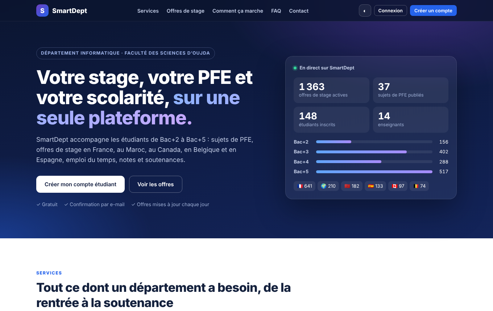
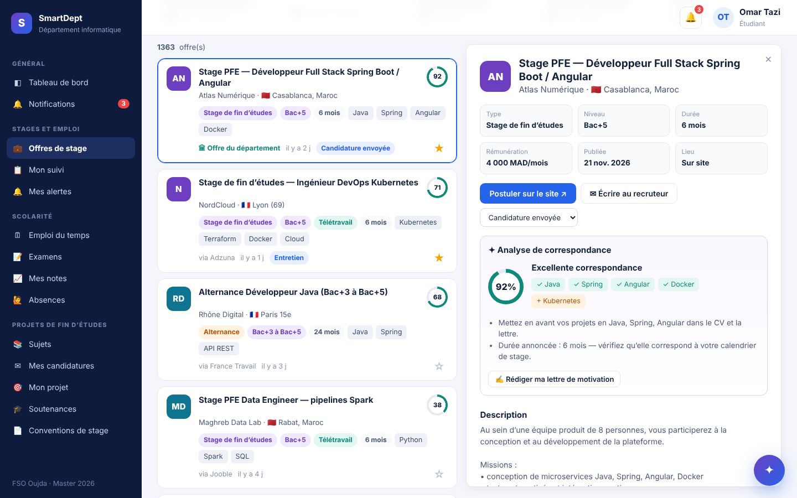
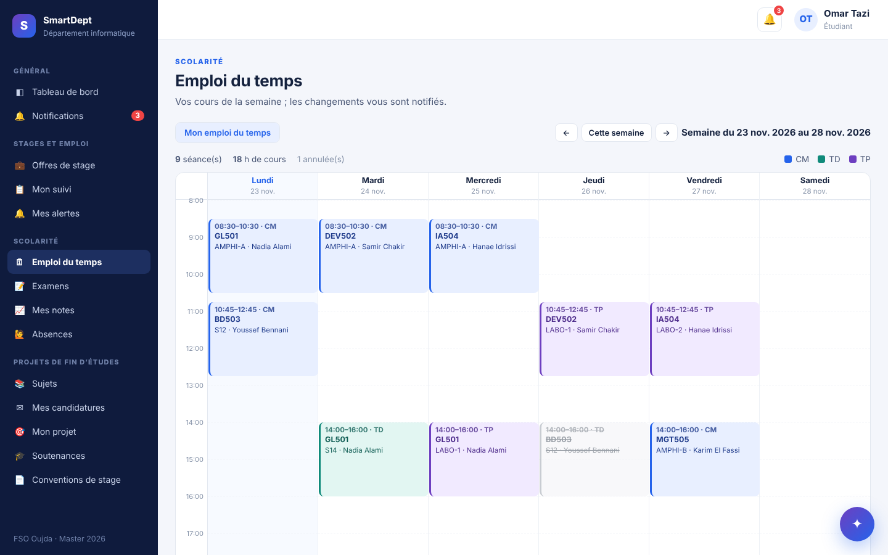
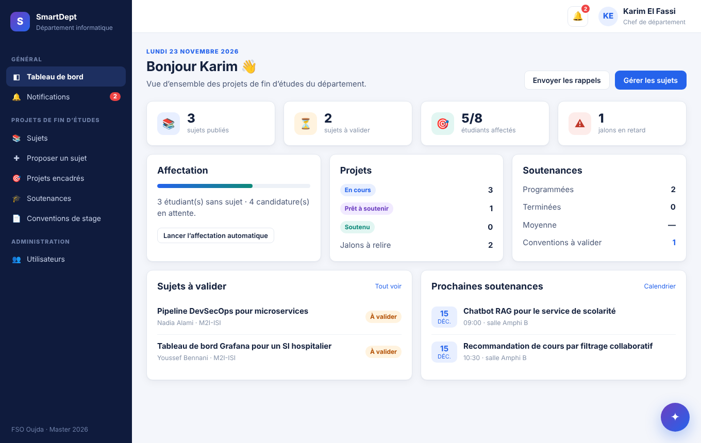
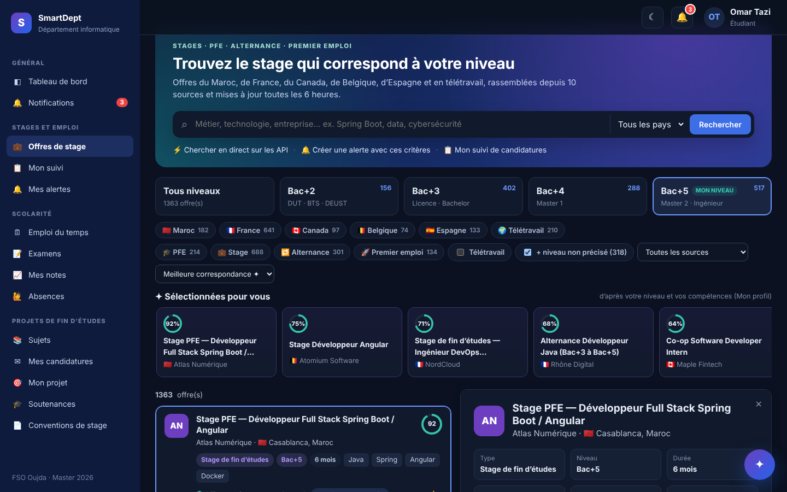
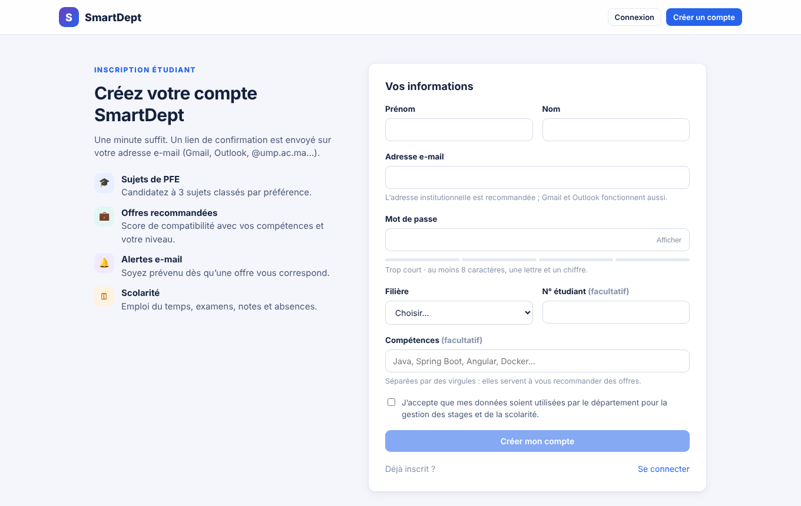
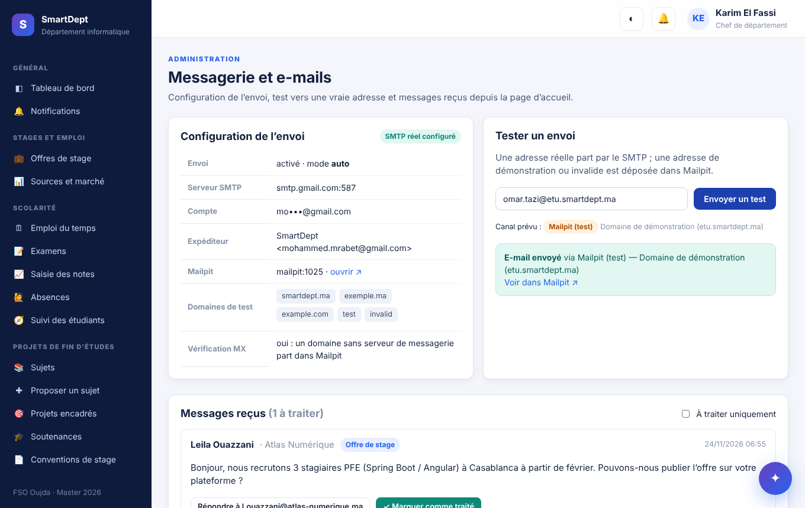
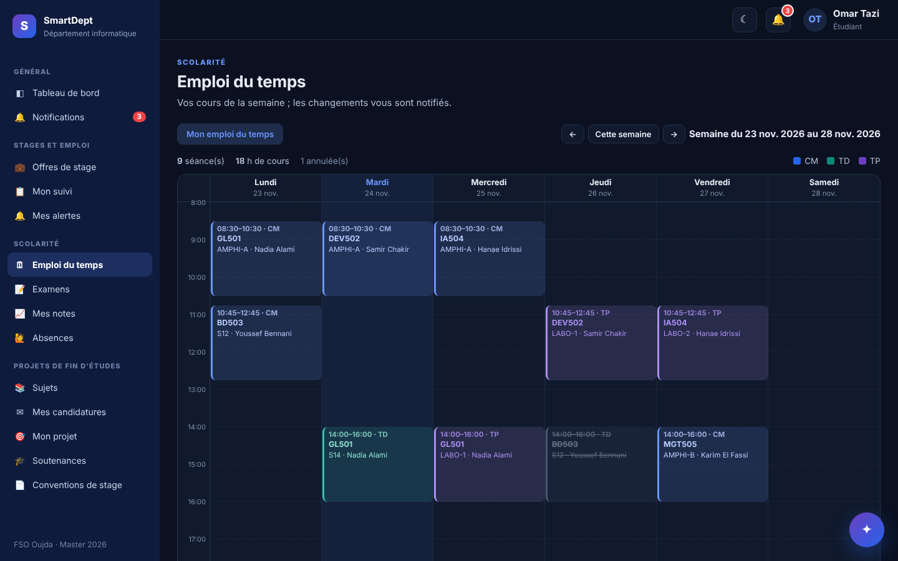

<div align="center">

# 🎓 SmartDept

**Plateforme de gestion du département informatique — stages, PFE, scolarité et DevOps**

[](https://github.com/mohammed-mrabet/smartdept/actions/workflows/ci.yml)


[Fonctionnalités](#1-fonctionnalités) · [Démarrage rapide](#-démarrage-rapide) · [Lancer le projet](#2-lancer-le-projet) · [Déploiement](#3-étape-3--déploiement) · [Tests](#4-tests-et-qualité) · [Architecture](#6-architecture)

<picture>
  <source media="(prefers-color-scheme: dark)" srcset="docs/captures/00-accueil-sombre.png">
  
</picture>

<sub>Captures réalisées avec les données de démonstration.</sub>

</div>

## ✨ En bref

SmartDept est l'application web du **département informatique de la Faculté des Sciences d'Oujda** (Université Mohammed Premier).
Elle réunit en un seul endroit ce dont ont besoin les étudiants, les enseignants et le chef de département :

| | |
| --- | --- |
| 💼 **Offres de stage réelles** | 9 API gratuites (Maroc, France, Canada, Belgique, Espagne, télétravail), filtrées sur l'informatique, de Bac+2 à Bac+5, avec score de compatibilité et alertes e-mail |
| 🎓 **Projets de fin d'études** | sujets, candidatures par préférence, affectation automatique, jalons notés, jury et soutenances |
| 🗓 **Scolarité** | emploi du temps généré sans conflit, examens, notes, moyennes, absences, suivi des étudiants en difficulté |
| 🌐 **Accueil public** | présentation des services, inscription étudiant avec confirmation par e-mail, contact |
| ✉️ **E-mails** | SMTP réel (Gmail, Brevo…) pour les vraies adresses, Mailpit pour les adresses de test |
| 🤖 **IA gratuite** | amélioration des sujets, suggestions, chatbot (Groq, Gemini ou Ollama, repli local sans clé) |
| 🌙 **Confort** | mode sombre, interface responsive, cache Redis |
| ⚙️ **DevOps** | Docker, Kubernetes, Jenkins, GitHub Actions, Trivy, Terraform (Azure), Ansible, Prometheus, Grafana, ELK |

<table>
  <tr>
    <td></td>
    <td></td>
  </tr>
  <tr>
    <td align="center"><sub>Offres de stage recommandées</sub></td>
    <td align="center"><sub>Emploi du temps généré</sub></td>
  </tr>
  <tr>
    <td></td>
    <td></td>
  </tr>
  <tr>
    <td align="center"><sub>Tableau de bord du chef de département</sub></td>
    <td align="center"><sub>Mode sombre</sub></td>
  </tr>
</table>

## 🚀 Démarrage rapide

Prérequis : [Docker Desktop](https://www.docker.com/products/docker-desktop/).

```bash
git clone https://github.com/mohammed-mrabet/smartdept.git
cd smartdept
cp .env.example .env        # facultatif : SMTP, clés IA et API d'offres
docker compose up -d --build
```

| Adresse | Service |
| --- | --- |
| http://localhost | application (accueil public) |
| http://localhost:8080/swagger-ui.html | documentation de l'API |
| http://localhost:8025 | Mailpit (e-mails de test) |

Comptes de démonstration (mot de passe `Demo@2026`) : `chef@smartdept.ma`, `admin@smartdept.ma`,
`n.alami@smartdept.ma` (enseignante), `omar.tazi@etu.smartdept.ma` (étudiant). La liste complète est plus bas.

## 🧱 Technologies

| Couche | Technologies |
| --- | --- |
| Backend | Java 21, Spring Boot 4.1, Spring Security + JWT, Spring Data JPA, Flyway, Spring Mail (SMTP réel + Mailpit), Spring Cache + Redis, Actuator + Micrometer, springdoc OpenAPI |
| Données | MySQL 8 (H2 en mode MySQL pour les tests), Redis 7 (cache et compteurs anti-abus) |
| Frontend | Angular 22 (composants standalone, signals, lazy loading), Vitest |
| IA | API compatible OpenAI : Ollama (local), Groq ou Gemini (gratuits), avec repli sur un moteur local sans clé |
| DevOps | Docker, Docker Compose, Kubernetes (Kustomize, HPA, Ingress), Jenkins, GitHub Actions, Trivy + SBOM, Terraform (Azure), Ansible, Prometheus, Alertmanager, Grafana, Elasticsearch + Kibana + Filebeat |

---

## 1. Fonctionnalités

### 1.1 Offres de stage, PFE, alternance et premier emploi (Maroc, France, Canada, Belgique, Espagne, télétravail)

Les offres viennent de **9 API gratuites** et des **offres publiées par le département**. Une synchronisation
tourne toutes les 6 heures ; un bouton « Chercher en direct » interroge les API à la demande.

| API | Pays | Accès gratuit | Variables |
| --- | --- | --- | --- |
| **France Travail** — Offres d'emploi v2 | 🇫🇷 | application sur francetravail.io (OAuth2) | `FRANCE_TRAVAIL_CLIENT_ID`, `FRANCE_TRAVAIL_CLIENT_SECRET` |
| **La bonne alternance** | 🇫🇷 alternance | compte sur api.apprentissage.beta.gouv.fr | `LBA_API_KEY` (et `LBA_SEARCH_URL` si le chemin change) |
| **Adzuna** | 🇫🇷 🇧🇪 🇪🇸 🇨🇦 | developer.adzuna.com | `ADZUNA_APP_ID`, `ADZUNA_APP_KEY` |
| **Jooble** | 🇲🇦 et tout pays | une clé par pays (ma.jooble.org/api/about…) | `JOOBLE_KEYS=MA:clé,FR:clé` |
| **Careerjet / Optioncarriere** | 🇲🇦 🇫🇷 🇧🇪 🇪🇸 🇨🇦 | compte éditeur Careerjet | `CAREERJET_API_KEY`, `CAREERJET_USER_IP` |
| **InfoJobs** | 🇪🇸 | developer.infojobs.net | `INFOJOBS_CLIENT_ID`, `INFOJOBS_CLIENT_SECRET` |
| **Remotive** | 🌍 télétravail | sans clé (4 appels par jour au plus) | — |
| **Jobicy** | 🌍 Europe, 🇨🇦 | sans clé (1 appel par heure au plus) | — |
| **Arbeitnow** | 🌍 Europe | sans clé | — |

Sans aucune clé, l'application fonctionne déjà avec Remotive, Jobicy, Arbeitnow et les offres du département.
Chaque fournisseur est indépendant : une API en panne ou sans clé n'empêche pas les autres de répondre.
La page **Sources et marché** montre l'état de chaque API (configurée, offres actives, dernière synchronisation).

Ce que fait SmartDept avec ces offres :

- **classification automatique** (les API ne donnent presque jamais ces informations) : type (PFE, stage,
  alternance, emploi), **niveau Bac+2 à Bac+5** (BTS, DUT, DEUST, licence, bachelor, master 1, master 2,
  ingénieur, en français, anglais et espagnol), compétences, durée, télétravail, pays ;
- **recherche** par niveau (le niveau de l'étudiant est présélectionné d'après sa filière), pays, type, source,
  télétravail, mots-clés ; compteurs par critère ; fiche détaillée à côté de la liste ;
- **score de correspondance** profil / offre pour chaque étudiant (compétences communes et manquantes, niveau),
  offres recommandées, conseils ;
- **lettre de motivation** générée par l'IA, ou modèle en français, espagnol ou anglais selon le pays ;
- **suivi des candidatures** en tableau (à postuler → envoyée → entretien → acceptée / refusée), avec
  **rappel de relance** automatique 14 jours après une candidature sans réponse ;
- **alertes** : une recherche enregistrée déclenche une notification (application + e-mail) à chaque nouvelle offre ;
- **offres du département** : un enseignant publie l'offre d'une entreprise partenaire, les étudiants du bon
  niveau sont prévenus ;
- **marché des stages** : répartition par pays et par niveau, compétences et entreprises les plus demandées.

Les offres externes restent liées à leur source d'origine (lien, nom de la source), comme le demandent les conditions des API.

**Filtre « informatique » et offres valides.** Avant d'être enregistrée, chaque offre reçue d'une API doit :
avoir un identifiant, un titre et un lien `http(s)` ; être publiée depuis moins de 45 jours ; relever de
l'informatique (développement, IA, data, DevOps, cloud, cybersécurité, réseaux, support IT…), d'après le titre
en français, anglais, espagnol ou allemand, ou, pour un titre générique, au moins 3 technologies dans la
description ; et ne pas viser un profil confirmé (senior, lead, head of, manager…). Les offres de vente,
comptabilité, RH, marketing, logistique, électrotechnique… sont écartées. Le nombre d'offres écartées est
indiqué pour chaque synchronisation dans **Sources et marché**, et les offres déjà en base sont refiltrées au
démarrage.

### 1.2 Scolarité (étape 2)

- **Emploi du temps** par filière, enseignant ou salle, ou « le mien » ; création en série hebdomadaire ;
  contrôle des conflits (salle, enseignant, filière, examens) avec un message 409 qui liste chaque conflit ;
  salle trop petite refusée ; annulation et déplacement notifiés aux étudiants.
- **Planification automatique de l'emploi du temps** : algorithme glouton à contraintes. Il respecte les
  disponibilités, met les TP en laboratoire et les CM le matin, répartit chaque module sur plusieurs jours et
  évite les fins d'après-midi. Le chef valide la proposition puis l'enregistre sur N semaines.
- **Examens** : salles cumulées selon l'effectif, surveillants, conflits ; **planification automatique d'une
  session** (un examen par jour et par filière, deux surveillants par salle, l'enseignant du module d'abord).
- **Notes** : saisie par composante (CC, examen, TP, rattrapage), publication notifiée, statistiques de classe ;
  **relevé** imprimable avec moyenne de module (30 % CC, 50 % examen, 20 % TP), validation à 10/20 et
  compensation (moyenne du semestre ≥ 10, note éliminatoire 5).
- **Absences** : appel en séance, justificatifs examinés par le chef de département, avertissement automatique
  à 3 absences non justifiées dans un module.
- **Suivi des étudiants** : score de risque de 0 à 100 (moyenne, modules ajournés, absences, jalons de PFE en
  retard), synthèse et actions proposées par l'IA, alerte hebdomadaire bienveillante aux étudiants à risque élevé.

### 1.3 Projets de fin d'études (étape 1)

Sujets validés par le chef, candidatures sur 3 sujets classés, **affectation automatique**, projet et jalons,
évaluation des livrables, soutenances (conflits de salle et de jury, **jury suggéré par l'IA**, note et mention),
conventions de stage imprimables.

### 1.4 Accueil public, inscription et comptes

- **Accueil** (`/`) visible sans connexion : services, chiffres en direct, dernières offres (sans lien de
  candidature), offres par niveau et par pays, parcours en 4 étapes, FAQ, formulaire de contact.
- **Inscription étudiant** (`/inscription`) : filière, compétences, force du mot de passe ; le compte est activé
  par un **lien reçu par e-mail** (24 h, usage unique) qui connecte directement l'étudiant.
- **Mot de passe oublié** : lien valable 1 h. Réponses identiques que le compte existe ou non.
- **Sécurité** : jetons de 256 bits dont seule l'empreinte SHA-256 est stockée ; limitation des tentatives
  (10 connexions / 15 min par adresse, 5 inscriptions, renvois, demandes ou messages par heure et par IP),
  champ piège anti-robot sur le contact.
- **Messagerie** (`/admin/messagerie`, chef et admin) : configuration SMTP, aperçu du canal pour une adresse,
  envoi d'un e-mail de test, messages reçus depuis l'accueil (à traiter / traités).

| | |
| --- | --- |
|  |  |

### 1.5 E-mails réels et Mailpit

Le routeur d'e-mails choisit le canal pour chaque destinataire :

| Destinataire | Canal |
| --- | --- |
| adresse réelle (`@gmail.com`, `@outlook.com`, `@ump.ac.ma`…) et SMTP configuré | **SMTP réel** |
| adresse de démonstration (`@smartdept.ma`, `@exemple.ma`, `example.com`, `.test`…) | Mailpit |
| adresse invalide ou domaine sans serveur de messagerie (vérification MX) | Mailpit |
| aucun `SMTP_HOST` renseigné, ou `MAIL_MODE=sandbox` | Mailpit |
| le SMTP réel refuse l'envoi | copie « [non délivré] » dans Mailpit, erreur visible dans la notification |

Configuration dans `.env` :

```bash
# Gmail : validation en 2 étapes + mot de passe d'application (myaccount.google.com/apppasswords), ~500 e-mails/jour
SMTP_HOST=smtp.gmail.com
SMTP_PORT=587
SMTP_USERNAME=votre.adresse@gmail.com
SMTP_PASSWORD=abcdefghijklmnop
# ou Brevo (gratuit, 300 e-mails/jour) : SMTP_HOST=smtp-relay.brevo.com + identifiant et clé SMTP + MAIL_FROM vérifié
```

Un compte **Outlook.com** personnel n'est pas conseillé comme *expéditeur* : Microsoft retire l'authentification
SMTP par mot de passe au profit d'OAuth. Les adresses Outlook **reçoivent** sans problème les e-mails envoyés par
Gmail ou Brevo. La page « Notifications » indique pour chaque e-mail le canal utilisé (SMTP ou Mailpit).

### 1.6 Cache Redis

`spring-boot-starter-cache` + Redis (`CACHE_TYPE=redis`) : filières, statistiques et facettes des offres,
statistiques et offres de l'accueil (durée de vie 10 min, préfixe `smartdept::`). Les caches des offres sont
vidés après chaque synchronisation ou publication. Les compteurs de limitation des tentatives sont aussi dans
Redis (`INCR` + `EXPIRE`), partagés entre plusieurs réplicas du backend. Si Redis tombe, l'application continue
(le cache est ignoré, les compteurs repassent en mémoire). Sans Docker (XAMPP), `CACHE_TYPE=simple` par défaut.

### 1.7 Mode sombre

Bouton ☀ / ☾ / ◐ dans la barre du haut, sur l'accueil et sur la connexion : thème clair, sombre ou celui du
système. Le choix est mémorisé dans le navigateur et appliqué avant le chargement d'Angular (pas de flash blanc).
Toutes les couleurs passent par des variables CSS (`styles.css`), redéfinies pour `[data-theme="dark"]`.

| | |
| --- | --- |
|  |  |

### 1.8 Notifications et IA

Chaque événement crée une notification dans l'application (cloche, page dédiée) et un e-mail HTML envoyé
après la validation de la transaction. L'assistant IA (Ollama, Groq ou Gemini) améliore les sujets,
suggère encadrants et jurys, rédige les lettres de motivation, explique les situations à risque et répond
dans le chatbot ; sans clé, un moteur local prend le relais.

---

## 2. Lancer le projet

### Comptes de démonstration — mot de passe `Demo@2026`

| Compte | Rôle | Niveau |
| --- | --- | --- |
| `admin@smartdept.ma` | Administrateur | |
| `chef@smartdept.ma` | Chef de département | |
| `n.alami@smartdept.ma`, `y.bennani@…`, `s.chakir@…`, `h.idrissi@…` | Enseignants | |
| `omar.tazi@etu.smartdept.ma`, `hamza.bennis@etu.smartdept.ma`… | Étudiants M2I-ISI | Bac+5 |
| `lina.sefrioui@etu.smartdept.ma` | Étudiante M1-GL | Bac+4 |
| `nora.alaoui@etu.smartdept.ma` | Étudiante LSI | Bac+3 |
| `sara.benjelloun@etu.smartdept.ma` | Étudiante DEUST-MIP | Bac+2 |

Les données de démonstration contiennent 5 filières, 20 utilisateurs, 7 salles, 17 modules, l'emploi du temps
de la semaine en cours, des examens, des notes, des absences et 24 offres de démonstration (entreprises fictives,
marquées « Démo » : on ne peut pas y postuler). Les **vraies offres** arrivent des API environ une minute après le
démarrage du backend (première synchronisation automatique), puis toutes les 6 heures. Elles ont un bouton
« Postuler sur le site ↗ » qui ouvre l'annonce d'origine. Sans aucune clé, Remotive, Jobicy et Arbeitnow
(télétravail) fonctionnent ; les clés gratuites de `.env.example` ajoutent le Maroc, la France, le Canada, la
Belgique et l'Espagne.

### Option A — Docker

```bash
cp .env.example .env              # facultatif : SMTP réel, clés IA et API d'offres
docker compose up -d --build
```

| URL | Service |
| --- | --- |
| http://localhost | accueil public, inscription et application |
| http://localhost:8080/swagger-ui.html | documentation de l'API |
| http://localhost:8025 | Mailpit : e-mails de test (adresses de démonstration ou invalides) |
| localhost:6379 | Redis (`docker compose exec redis redis-cli keys 'smartdept::*'`) |

Au premier démarrage, MySQL 8.4 affiche des avertissements `'VALUES function' is deprecated` pendant le
chargement des données de démonstration : ils sont sans effet. La syntaxe `VALUES()` est gardée exprès, car la
syntaxe de remplacement (`INSERT … AS alias`) n'existe pas dans MariaDB, la base fournie avec XAMPP (option B).

Supervision complète : `docker compose -f docker-compose.yml -f docker-compose.observability.yml up -d`

| URL | Service |
| --- | --- |
| http://localhost:3000 | Grafana (admin / smartdept), tableau de bord « SmartDept — application » |
| http://localhost:9090 | Prometheus (règles d'alerte dans `monitoring/prometheus/alerts.yml`) |
| http://localhost:9093 | Alertmanager (les alertes arrivent dans Mailpit) |
| http://localhost:5601 | Kibana (index `smartdept-*`, journaux JSON au format ECS) |

### Option B — XAMPP + Maven + Angular

```bash
# MySQL de XAMPP démarré (mot de passe root vide)
cd backend && ./mvnw spring-boot:run
cd frontend && npm install && npm start      # http://localhost:4200
```

### Activer l'IA gratuite et les API d'offres

Tout se règle dans `.env` (Docker) ou en variables d'environnement : voir `.env.example`.
`GET /api/ai/status` indique le fournisseur IA ; la page **Sources et marché** indique les API d'offres actives
et permet de lancer une synchronisation.

---

## 3. Étape 3 : déploiement

### Kubernetes (minikube, Docker Desktop ou AKS)

```bash
minikube start && minikube addons enable ingress metrics-server
kubectl apply -f k8s/namespace.yaml
kubectl -n smartdept create secret generic smartdept-secrets \
  --from-literal=DB_PASSWORD=motdepasse --from-literal=MYSQL_ROOT_PASSWORD=motdepasse \
  --from-literal=JWT_SECRET=une-longue-chaine-aleatoire-de-plus-de-32-caracteres
cd k8s && kustomize edit set image DOCKERHUB_USER/smartdept-backend=moncompte/smartdept-backend:latest \
  DOCKERHUB_USER/smartdept-frontend=moncompte/smartdept-frontend:latest && cd ..
kubectl apply -k k8s/
kubectl -n smartdept get pods -w
```

Contenu : MySQL en StatefulSet avec volume, backend en 2 à 5 réplicas (HPA sur le CPU) avec sondes
liveness/readiness, frontend en 2 réplicas, Ingress `smartdept.local`, NetworkPolicy (seul le backend
accède à MySQL), annotations Prometheus. Supervision : `k8s/monitoring/` (chart kube-prometheus-stack + ServiceMonitor).

### Azure avec Terraform puis Ansible

```bash
cd terraform/azure
cp terraform.tfvars.example terraform.tfvars     # abonnement, votre IP
az login && terraform init && terraform apply     # VM Ubuntu B2s, IP publique, pare-feu ; écrit ansible/inventory.ini
cd ../../ansible
ansible-galaxy collection install -r requirements.yml
ansible-vault create group_vars/vault.yml          # secrets, modèle : group_vars/vault.example.yml
ansible-playbook site.yml --ask-vault-pass        # Docker, pare-feu, application, supervision
```

Mise à jour d'une version : `ansible-playbook site.yml --tags app -e image_tag=<sha>`.
Pensez à `terraform destroy` après la démonstration pour préserver le crédit Azure for Students.

### Jenkins

```bash
docker compose -f jenkins/docker-compose.yml up -d --build     # http://localhost:8081
```

Créer un pipeline multibranche sur le dépôt. Le `Jenkinsfile` enchaîne : tests backend (JUnit + couverture
JaCoCo) et frontend en parallèle, SonarQube s'il est configuré, images Docker, scan Trivy et SBOM, publication
sur Docker Hub (branche main), validation manuelle, puis déploiement Kubernetes ou Azure (Ansible).
Identifiants attendus : `dockerhub`, `kubeconfig`, `ssh-azure`.

### GitHub Actions

`.github/workflows/ci.yml` : tests et couverture, build du frontend, **validation de l'infrastructure**
(terraform fmt/validate, kubeconform, ansible-lint), images Docker, Trivy, SBOM, push Docker Hub sur main.

---

## 4. Tests et qualité

```bash
cd backend && ./mvnw test      # JaCoCo : target/site/jacoco/index.html
cd frontend && npm test
```

- **Offres** : classification (types, niveaux en 3 langues, compétences, pays), lecture des réponses de chaque
  API à partir d'exemples, synchronisation (API en échec, délai minimal, recherche en direct), alertes et
  relances, score et lettre de motivation, intégration H2 (recherche par niveau, offres internes, suivi).
- **Scolarité** : calcul des notes et compensation, planificateur d'emploi du temps (aucun conflit, TP en
  laboratoire, répartition sur la semaine), planificateur d'examens, score de risque, intégration H2
  (conflits 409, séries, planification, appel et avertissements, relevé).
- **Comptes et e-mails** : routage SMTP / Mailpit, limitation des tentatives (mémoire et repli si Redis
  est absent), inscription → confirmation → connexion, mot de passe oublié, force du mot de passe (Vitest).
- **PFE** : règles des sujets, candidatures, jalons, soutenances, conventions, parcours complet sur H2.

## 5. Correspondance avec les TP du module

| TP | Mise en œuvre |
| --- | --- |
| TP0 Scrum / Jira | trois étapes livrables (feuille de route ci-dessous) |
| TP1 Git | historique local, branches `main` et `develop` |
| TP2 Tests | JUnit 5, Mockito, H2, JaCoCo, Vitest |
| TP3-1 Docker / Docker Hub | Dockerfiles multi-étapes (backend sans droits root), publication automatique |
| TP3-2 Kubernetes / Docker Compose | `k8s/` (Kustomize, StatefulSet, HPA, Ingress, NetworkPolicy), `docker-compose*.yml` |
| TP4 Azure | VM Ubuntu sur Azure, déploiement par Ansible |
| TP5 Flyway | `V1` à `V4` + données de démonstration répétables |
| TP6 Jenkins | `Jenkinsfile`, image Jenkins prête (`jenkins/`) |
| TP7 GitHub Actions | `.github/workflows/ci.yml` |
| TP8 Terraform | `terraform/azure` (réseau, pare-feu, IP, VM, inventaire Ansible généré) |
| TP9 Ansible | `ansible/` (rôles common, docker, app, monitoring ; secrets avec Ansible Vault) |
| TP10 Supervision / DevSecOps | Prometheus + alertes, Alertmanager, Grafana, ELK, Trivy, SBOM, ufw, fail2ban |

## 6. Architecture

```
backend/src/main/java/ma/ump/smartdept
├── offers/        offres : fournisseurs d'API, classification, synchronisation, alertes, IA, suivi
├── academic/      scolarité : salles, modules, séances, examens, notes, absences, planificateurs, risques
├── pfe/           sujets, candidatures, projets, jalons, soutenances, conventions
├── notification/  notifications, routeur d'e-mails (SMTP réel / Mailpit), modèles HTML
├── publicsite/    API publique de l'accueil, contact, messagerie de l'administration
├── ai/            client IA compatible OpenAI, moteur local, chatbot
├── user/ security/ common/ config/
frontend/src/app/pages   public/ (accueil, inscription, mot de passe) · offers/ · academic/ · pfe/ · dashboard/ · notifications/ · profile/ · admin/
k8s/ · terraform/azure/ · ansible/ · jenkins/ · monitoring/ · docs/uml/ · docs/captures/
```

Diagrammes dans `docs/uml/` : cas d'utilisation, classes PFE, classes scolarité, architecture des offres,
chaîne de déploiement, séquence « acceptation d'une candidature ».

## 7. Feuille de route

- **Étape 1** : PFE, notifications, IA, Docker, GitHub Actions — livrée.
- **Étape 2** : scolarité (emploi du temps, examens, notes, absences, planification, suivi des étudiants) — livrée.
- **Étape 3** : offres de stage multi-pays, Kubernetes, Jenkins, Terraform, Ansible, Azure, Prometheus, Grafana, ELK — livrée.
- **Étape 4** : accueil public, inscription avec confirmation par e-mail, e-mails réels (SMTP) + Mailpit, Redis — livrée.
- Pistes : dépôt de pièces jointes (CV, justificatifs) sur un stockage objet, application mobile, authentification
  universitaire (SSO).

---

## 👤 Auteur

**Mohammed MRABET** — Master, Faculté des Sciences d'Oujda (Université Mohammed Premier), 2026
GitHub : [@mohammed-mrabet](https://github.com/mohammed-mrabet)

Projet individuel réalisé dans le cadre du module Génie logiciel / DevOps.
Une partie du code a été écrite avec l'aide d'un assistant IA (Claude, Anthropic) ;
la conception, les choix techniques, les tests et l'intégration ont été faits et vérifiés par moi.
